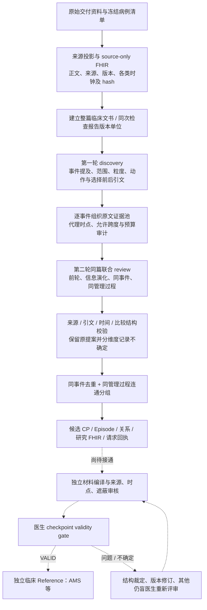

# Checkpoint–Episode 当前流程、改进证据与专家盲评差距

审计日期：2026-10-27（Asia/Shanghai）。依据当前工作区代码、冻结配置、实际请求回执和本地产物；本轮未调用临床模型、未修改解析/纳入/episode规则、未覆盖既有结果。本文是工程与研究流程审计，不是临床验证。研究约束以根目录 AGENTS.md 为准。

当前已经形成可审计的自动候选重建流程，尚未形成专家盲评闭环。DeepSeek 本轮是冻结算法的换模型重跑；它没有新增材料遮蔽能力，也未完成全部十例。现有结果支持部分来源组织与记录完整性改善，但不支持“整体更可靠”或“Episode 已验证”的结论。

## 1. 先分清现在到底运行哪一条流程

| 层次 | 当前对象 | 实际状态 |
|---|---|---|
| 自动候选重建 | `scripts/cohort_construction/p2_auto_checkpoint_v04/`，配置版本 v0.5 | 两轮 LLM + 来源/时间/结构核验；实现目录名尚未改版 |
| Qwen 主结果 | `private/p2_auto_checkpoint_v0.5_20261027/release_primary_recovered/` | 十例技术完成；369 条语义记录、56 个候选 CP、28 个候选管理过程 |
| DeepSeek 对照 | `p2_auto_checkpoint_model_rerun` + `config/p2_auto_checkpoint_v05_deepseek.json` | 仅替换模型；7/10 技术完整，未发布完整 release、未整体评分 |
| 条件依据反馈 | `p2_auto_checkpoint_v05_refine/` | Qwen 六例部分技术试验，未进入主比较；DeepSeek 未启用 |
| 旧 Decision Graph / annotation / review workflow | `p2_relation_graph/` | 重建标注、结构裁定和临床评审登记工具可复用；不是当前自动重建入口 |
| 旧 HEWV 四问 | `pancreatic_agent.episode_extract`、`contracts/v0.4/` | 保留的另一套历史实现；不能据此重新定义当前 P2 Episode |

当前自动重建主要对应 [文书整体语义 contract](P2-文书整体语义判断与开发指标-contract-v0.4-20261025.md)。它与 HEWV 的 `contracts/v0.4` 同名但不是同一版本体系。根 README 和 cohort_construction README 仍有较早的“当前入口”表述，应建立唯一 active release 索引，显式列出 source、code、config、model、metric、packet contract 的 hash。

主入口 `p2_auto_checkpoint_v04/run.py:49` 默认 Qwen v05 配置；DeepSeek 适配入口 `p2_auto_checkpoint_model_rerun/run.py:75` 注入 DeepSeek 配置。模型选择需以该次请求/配置回执为准。

## 2. 当前完整数据流



| 步骤 | 已实现内容 | 边界或缺口 | 代码定位 |
|---|---|---|---|
| 选样与来源 | 固定十例来源清单，FHIR 只读导入原始资源；忽略 Basic/Provenance 研究标签 | 当前入口无 P1 PASS 硬门槛；已有资料目录不等于模型实际收到正文 | `run.py:19–28,54–64`；`p2_auto_checkpoint/fhir_io.py:72–124` |
| 单位路由 | 临床文书整篇、同次影像检查的报告版本组 | 护理/同意/评分等支持文书未进主发现；保留在上下文不等于已检查其决策 | `context.py:67–101,156–186` |
| 发现 | LLM 判断零至多个事件；提出动作、选择边界、选择前事实、执行后事实、时间依据 | 每篇最多十事件；零发现不会进入第二轮，第二轮不能新增 ID | `engine.py:53–98,470–476`；`prompts.py:32,37–42,126` |
| 证据组织 | 按事件累积原文，排除当前选择/后续事实；术中按阶段，检查自己的报告不证明当初选择理由 | 源日期、报告日期、手术开始等保留代理身份；允许引用区不是已认证盲评材料 | `context.py:433–653`；`temporal.py`；`source_time.py` |
| 复核 | 同篇事件一起复核，提供发现阶段前轮 ledger、各事件证据池及当前全文 | 当前全文有实际选择，明确为 reconstruction-only；复核不等于医生盲评 | `engine.py:285–389`，尤其 `312–314` |
| 核验 | 逐字 source/hash/span、前轮 ID、前后信息比较、显式再解释、逐条可见性声明、七维不确定性 | 引文真实不等于语义成立；模型声明“明确已知”仍需独立审核 | `engine.py:110–144,208–282,358–381`；`validation.py` |
| 组装 | supported 同过程边进行连通合并；同事件候选 canonical 去重 | Episode 是候选管理过程连通分组；未完成最终前轮资格和全图一致性核验 | `engine.py:392–454` |
| 保存 | discovery/review 原输出、事件、证据池、关系、失败、请求 hash、FHIR 与本地引用校验 | FHIR 格式通过不认证临床可见性、Episode 语义或专家材料质量 | `engine.py:488–500`；`run.py:29–39` |

“起始锚点”“新证据 CP”“重复/执行”“不确定”分别保留。起始锚点没有两轮可比，不能并入新证据演化分母。复合计划不因含多个动作而自动拆成多个决策；相同动作也可能在新信息后构成再评估。

## 3. 上一轮 DeepSeek 重跑实际完成了什么

最新终态见 [技术未完成报告](../private/p2_auto_checkpoint_v0.5_deepseek_v4.1_flash_20261027/模型替换重跑技术未完成报告.md) 和该目录 `CURRENT_RUN.json`、`FINAL_VERIFICATION_RECEIPT.json`。

- 技术完整 7/10：SCALE-01、02、05、06、07、08、09；03、04、10 各四次 attempt 后仍未完整。
- 原始 invocation 694 次：588 成功、106 失败；共 972 次请求尝试。失败尝试异常为 SSLError 291、ConnectionError 42、ValidationError 50、ValueError 1；不是互斥病例数或临床错误数。
- 冻结算法、prompt、schema、字符边界规则、源资料和 seed 不变；未新增 LLM 精确语义 mask，也未启用条件依据反馈。
- 冻结清单核验：十个来源文件、39 个代码/配置文件及 143 个受保护 Qwen 产物 hash 一致。339 个可核对的原始 discovery 请求仅模型项不同；review 输入会随模型发现结果自然分叉。
- 既有 83 项 AI 开发参考覆盖固定七例，其中 DeepSeek 目前只完成四例。不能把“成功七例”误认作“参考七例”，也不能缩小分母宣称全套性能。

技术失败说明本次未取得完整可用输出，不等于患者资料差，也不能仅凭异常类型定位网络根因。病例最多四次 attempt 的预算是在初始技术失败后另行登记，应保留这一时间顺序。

条件依据 refinement 与格式恢复也必须分开：前者是同原文上的一次语义证明反馈，后者仅是 JSON/schema 提醒。Qwen 可选 refinement 六例、62 请求组中仅十组成功返回，未形成与主结果可直接合并的完整比较。

## 4. 哪些改进有证据，哪些没有

以下只比较 v0.4.3 与 Qwen v0.5 主结果，用同一新增分层定义重算。参考是固定十例中的七例、83 个 AI 原文开发挑战项，非穷尽、非专家 gold。完整定义和认证请求见 [同口径指标报告](../private/p2_auto_checkpoint_v0.5_20261027/同口径指标与逐项差异报告.md)、[指标定义](../private/p2_auto_checkpoint_v0.5_20261027/metric_definitions.md)。

| 同口径指标 | v0.4.3 | Qwen v0.5 主结果 | 能支持的结论 |
|---|---:|---:|---|
| 发现/最终保留原文提及 | 40/40 | 39/40 | 有一项目标未定位/保留，不能称发现整体改善 |
| 确定新证据 CP 来源对齐 | 27/30 | 11/30 | 按当前开发参考，CP 选择层明显下降；还需辨别保护性拦截与错误损失 |
| 起始锚点来源对齐 | 4/6 | 6/6 | 指定六个初始目标的来源对齐改善 |
| 必需来源跨度实际进入相应请求 | 50/53 | 53/53 | 这 53 个目标×来源跨度的覆盖改善，未证明完整临床事实覆盖 |
| 负例主要锚点被选独立事件/CP | 0/29 | 0/29 | 该定位诊断没有变化；不能推出全部输出无假阳性 |
| 七维不确定性记录完整 | 未测量 | 261/261 | 七例输出记录的格式完整，不是七维判断准确率 |
| 新 CP 比较依据记录完整 | 未测量 | 18/19 | 七例新 CP 的证明记录完整度，分母不是30个参考目标 |

全十例候选 CP 数 146→56，不能把数量下降当降噪成功。v0.5 同时改了模型、提示和代码，整版差异不能归因于单独因素。旧输出在新指标下的 35/40→40/40 等变化是统计问题定义变化，不能当成重跑改进。

对下降已存在逐项诊断：[CP 来源对齐审计](../private/p2_auto_checkpoint_v0.5_20261027/cp_alignment_regression_audit.md)。三十目标中十一项旧新均对齐，十六项旧对齐而本版未对齐，三项旧新均未对齐；当前十九项未对齐不是十九个新增错误。十九项中十六项被契约阻挡，两项判为 repeat/execution，一项无最终 action 匹配；十六个阻挡包含十一项引文/比较证明失败、四项 execution 与 new_evidence 内部冲突、一项 proxy-only 可见性声明。十九目标预指定的二十三个所需跨度全部已输入，不能统一解释为原文或患者证据缺失。

已实现且有合成反例的工程能力包括：同日粗时间不强排序、术中开始只作检索边界、显式选择时间需要来源证明、内镜申请签署日只作记录代理、完整选择子句与动作证明分开、原始提案和实际请求可回溯。它们证明程序约束更明确，不自动证明临床语义更准确。

目前仍无完整参考可测：独立事件合并/拆分、真正前轮、证据新颖性及判断连接、完整 Episode、全病例 precision/recall/F1、盲评泄漏率。`evaluate_layers.py:315–325` 已返回 `not_measured`，不应在汇报中省略这些缺口。

## 5. 本轮问题登记与证据强度

下列为稳定审计编号，不替代已有回归目录。后续修复应将失败样例和阳性/阴性对照迁入正式测试及 issue map，不能仅改规则。此次只新增审计材料，未改变算法输出。

| 编号 | 问题 | 当前证据 | 修复后必须核对 |
|---|---|---|---|
| CE-AUD-001 | 发现 ledger 的前轮最终被降级后，后续候选和过程边不重新核验 | 代码 + 纯虚构复现；Qwen 26 个新 CP 的前轮终态为：15重复/执行、8契约未定、2新CP、1无关/generic | 正确当前/历史/执行载体、canonical、跨过程及缺前轮对照；不得要求每个前轮本身都是被选CP；报告图/CP/Episode迁移 |
| CE-AUD-002 | 格式恢复读取共享 `receipts[-1]`，并发时可能取错请求 | 同病例共享 Client；纯合成交错顺序可使 schema 失败请求跳过提醒。未证实实际运行哪些失败由此造成 | 按本次 request hash/异常 receipt 判定；A失败/B成功及相反交错、网络失败、既有成功缓存、一次反馈上限对照 |
| CE-AUD-003 | 主发现未覆盖支持文书；零发现无补召回、review 不能新增ID | 代码已确认；Qwen 347 单位中25个零发现，其余最多4事件，没有观察到十事件上限饱和 | 支持文书真实新判断/纯执行对照；独立审核零命中样本；十事件饱和保护。25个零发现不是25个漏诊 |
| CE-AUD-004 | 真实选择前状态与同文选择/执行隔离尚未独立认证 | Qwen 56候选均 `availability_certified=false`、`blind_replay_ready=false`；均无显式 choice_time，42用记录代理、8术中阶段、其余6未知/历史不明 | 逐来源版本/时间/内容核验；无精确分钟不自动无效；保留不确定，不用后续结局回填 |
| CE-AUD-005 | 当前材料编译/契约版本没有统一 | HEWV整篇可见与后续span阶段重建是不同合同；自动重建请求仍披露真实选择 | 指定 active packet contract；分别声明严格时点回放/回顾性阶段重建资格，不能暗中兼容 |
| CE-AUD-006 | 目前评估主要是来源跨度和字段结构，缺独立语义与Episode依据 | AI开发挑战非穷尽；完整Episode/前轮等明确未测量 | 新样本完整局部原文双人独立重建、分歧裁定；A重建依据与B临床Reference隔离 |

CE-AUD-001 的代码为 `engine.py:110–144,404–453,470–476`；CE-AUD-002 为 `p2_auto_checkpoint_model_rerun/run.py:42–52`，Qwen `shape_retry` 有同一逻辑。异常回执 `client.py:66–68` 仅存错误类，后续可增加不含正文/凭证的 schema 路径、截断或传输分类，改善诊断。

前轮终态统计是结构待核信号，不是24个临床错误；重复文书可能承载真正既往决定，未成为候选的记录也可能是合法前轮。真正要核验的是身份、原文支持、时点及最终图能否一致解释。

## 6. 离专家盲评 Checkpoint 具体还差什么

已有可复用的 [衔接流程](P2-重建验证与医生盲评衔接流程-v0.3-20261023.md) 和 `p2_relation_graph/review_workflow.py`：包注册、冻结表单 hash、接触史、有效性门槛、结构裁定、追加版本、旧评分隔离和重新盲评。当前是台账工具，未自动制造正式临床包，也不验证真实访问权限或人员身份。

| 必须补齐 | 最小交付物 | 可审查的验收依据 |
|---|---|---|
| 研究问题与资格冻结 | active pipeline + CP/Episode/packet contract；明确独立决策或plan_review、严格时点或阶段重建、相关围手术范围 | 不凭“做过手术”或P1 PASS决定相关性；新锚点与新信息轮分开，scope未定保留 |
| 原文材料包 | 先用小批候选做独立 compiler；逐来源 KEEP/MASK/REVIEW、来源等级、原文坐标、时钟依据、已计划未返回和原报告未找到状态 | 医生可见内容只有中性问题和按方案允许的原始临床资料；不得以模型解释替代病历 |
| 全包遮蔽审核 | 针对本目标审查当前动作、重复文书回述、实施/反应/结局、标题、字段、附件与链接 | 既往真实计划保留；当前选择与后续结果不绕过遮蔽；不要把合法依据一起删掉；完整研究FHIR原附件不能直接暴露 |
| 可回溯冻结 | packet_id/version、父版本、source/code/rule/clinical-content hash、截点、审核人及时间 | 医生与后续Agent消费同一临床内容；差异只限角色说明，不能向一方另加材料 |
| 正式表单与人员流程 | 冻结 validity 与临床Reference schema；明确 AMS、动作、Severity、Confidence、无法判断和分歧处理 | 历史三mode/四问不自动成为正式表单；台账默认两份validity不替代正式专家人数方案 |
| 真实试评 | validity→通过后Reference；问题/未定进结构裁定，新版本由仍盲的其他医生重新评 | 首次自动proposal分母、待评、修订动作、人时和旧评分均保留；未完成不能伪装零问题 |

VALID 表示研究问题、时间边界和材料能评价，不要求证据足够推进手术、不要求唯一行动，也不自动确认独立 Episode。局部来源缺口或时间不精确应按具体包处理，不升级成患者排除。

不必等待全队列人工 gold、完整反事实模拟器、正式 FHIR 服务器或 DeepSeek 全十例完成后才做小批专家试评。对拟送审的小批包完成规定审核即可启动；算法扩大验证和材料试评可以并行。对外的性能或全队列声明则需要相应独立证据。

## 7. 怎样让下一轮能证明改进

建议把后续工作拆成可独立比较的四个交付，避免再次把换模型、代码、材料和指标一起变更。

1. **先做有定位的工程修复。** CE-AUD-001/002 合成失败例及必要对照进入回归；对既有十一项引文/比较阻挡逐项核查。不要自动截短引文或把模型内部矛盾强行改成阳性。保留当前源文、规则与结果快照。
2. **同源、同模型、同指标比较一次代码变更。** 主报技术完成、实际材料覆盖、引文/边界错误、前轮与全图一致性、CP/episode变动及原因。修复格式错误、恢复候选数量只是中间指标；新增/恢复/消失候选需要独立核查，不能只数通过数。
3. **另设未参与开发的独立重建集。** 按完整局部范围双人独立看原文，之后裁定；包含零命中、待核、不同P1状态、未手术/暂缓/不推进等过程。固定十例虽由P0随机抽样且不以手术筛选，实际恰均有切除记录，尚不能覆盖这些路径。分别评价事件身份、前轮、演化连接与过程分组，不用一项source overlap代替全部。
4. **用包质量证明“更接近专家盲评”。** 盲化版本做材料审核，报告首次自动proposal的 VALID/全部、VALID/已评、待评数、确认遗漏/泄漏、修订次数与实际人时；结构问题标记率与裁定确认错误率分开。之后在冻结最终包上形成独立临床Reference。

固定算法的换模型比较继续单独保留；DeepSeek未完成部分不缩小固定分母，也不为得到好看的候选数量反复请求。已有 contract 的90%发现、80%新CP、95%必需跨度是开发目标，不能直接转成临床盲评自动接受门槛；扩大验证的误差容许范围需事先单独定义。

## 8. 本轮离线核验

重新运行当前自动重建、分层评价、条件依据反馈、模型替换与格式恢复的合成测试：`302 passed, 23 subtests passed`（Python 3.12.4，25.01秒）。命令为：

```sh
python3 -m pytest -q scripts/cohort_construction/p2_auto_checkpoint_v04/tests scripts/cohort_construction/p2_auto_checkpoint_v05_refine scripts/cohort_construction/p2_auto_checkpoint_model_rerun scripts/cohort_construction/p2_auto_checkpoint_shape_retry
```

这证明已列程序回归通过，不证明未覆盖的图一致性、并发交错或临床问题已解决。新增审计复现与聚合核验保存在 `private/p2_checkpoint_episode_pipeline_audit_20261027/`；不存在专家已审或新模型已重跑的隐含声明。本轮不涉及P1变更，未改变队列或来源核对结果。
