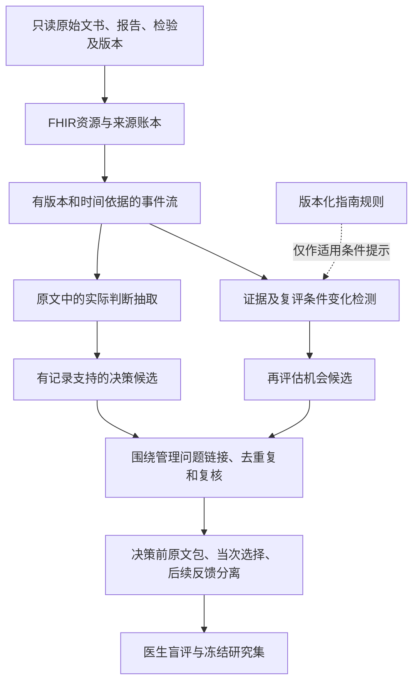

# FHIR 支撑的临床决策 Episode 回放：可实施框架 v0.1

研究/实现核对日期：2026-10-22。用途：PDAC 可切除性与根治切除路径研究；可迁移到其他纵向决策研究。本文区分外部标准、我们的研究定义、已运行原型和待验证模块。

## 1. 结论与直观理解

**可行，但可复用的方法必须同时包含资料标准、时间回放、决策抽取和人工验证。FHIR 主要解决资料如何一致地表达与交换；它不会自动判断哪里发生了临床决策。**

可以把 FHIR 理解为一套有固定字段和相互引用关系的病历卡片：检验卡、影像报告卡、诊疗计划卡、已实施操作卡、原始文书卡。HL7 是发布这一标准的组织；FHIR 既有数据模型，也定义交换接口。把报告装入卡片不要求先把报告的临床意思全部解释成标签。[FHIR 官方说明](https://hl7.org/fhir/R5/index.html)

我们的研究对象需要另外三个对象，均为**本研究的定义**，不冒称 HL7 原生资源：

- `DecisionRecord`：原文记录了一次当下的判断、选择、维持、暂缓或条件性安排；必须有出处和语义证据。
- `DecisionOpportunity`：新信息/已约定的复评条件可能值得重新判断，但尚无证据证明医生已作判断。
- `ResearchEpisode`：围绕一项持续的管理问题组织前后资料与决策，允许跨住院、多个问题并行和边界不确定。

“实际决策点”在回顾性研究中首先意味着**有记录支持的决策**。未被记录的心理过程、真实首次形成意向的秒级时间，不能靠 FHIR 或语言模型补出来。

## 2. 分享对话里哪些建议采用，哪些必须修正

已通过浏览器读取分享页面中的 FHIR、state、CQL、PlanDefinition 和 MIRA 相关段落。网页初次文本抓取为空，未把空抓取当成读过全文。[用户提供的对话](https://chatgpt.com/share/6ad9c0d9-266c-83ec-b275-7ff6c3118ed4)

| 对话中的建议 | 可行性判断与修正 |
|---|---|
| Raw EHR → FHIR → state → 回放 | 采用。但首先保留原文与来源；结构化断言属于可审计的派生层，不自动变成真值。 |
| 用 StructureMap 转换数据 | 适合字段、类型、术语转换；中文文本中的否定、历史、计划和真实执行，需要另做语义提取。StructureMap 本身不提供这些临床理解能力。 |
| 显式 State Variable Contract | 采用。补充对象、来源、时间、版本、缺失性质、冲突及证据范围，避免一个患者级标签覆盖全部病程。 |
| pathology > imaging 的统一优先级 | 不直接采用。先匹配病灶、时间、取样部位和问题；后来的胰腺病理不能推翻较早对肝病灶的未知状态，阴性穿刺也不总能覆盖可疑影像。 |
| MRI 判肝病灶 likely benign → 全患者无转移证据 | 不能直接推出。该灶的解释改善与全身分期是不同对象和证据范围。 |
| 仅 final report 返回才可能出现新证据 | 太窄。有出处的初步报告、复核或临床记录中的已知结果也可能有效；保留 preliminary/amended 等版本。只有检查完成时间，则不能冒充结果可见时间。 |
| `A(S_t) != A(S_t-1)` 才生成决策点 | **不能作为必要或充分条件。** 同样的动作仍可被重新选择；集合变化也不证明实际发生决策。它最多是机会检测的一项信号。 |
| 指南引擎输出 admissible action set | 改为 `guideline_applicability_hints`。它是我们编码出的建议与条件，不能代替五名专家盲评的 Acceptable Mode Set。 |
| 用 FHIR 现有 episode 对象 | `EpisodeOfCare` 表示患者与照护机构/提供者的一段责任关系，不能仅因名字相同就等同于本研究的 decision episode。 |

上述边界分别可核对 [StructureMap](https://hl7.org/fhir/R4/mapping-language.html)、[EpisodeOfCare](https://hl7.org/fhir/R4/episodeofcare.html) 和 [PlanDefinition/$apply](https://hl7.org/fhir/R4/plandefinition-operation-apply.html)。对其研究适用性的判断是本项目的方法学分析。

最重要的修订是：**让“有出处的实际判断”与“证据触发的再评估机会”两路进入回放；不让指南计算结果决定我们是否承认临床决策发生。**

## 3. MIRA 实际做了什么，可以借什么

核对的是 Ferber 等的 Nature 原文《Towards autonomous medical artificial intelligence agents》及公开仓库，不以二手报道代替方法。论文把 FHIR 用于沙盒 EHR 的请求与结果交换；HAPI-FHIR 在本地 Docker 中运行。Agent 使用结构化工具，获取基于病例的检查结果并提交诊疗动作；Plan 推理工具本身在 FHIR 之外。[论文方法](https://www.nature.com/articles/s41586-026-10675-5)

本次固定审阅仓库 commit：`73666b1a9ec3a0d9cfb078d31e546d01a581a3e4`。检查了 `mimic_to_fhir.py`、`fhir_observations.py`、`fhir_handlers.py`、`tool_execs.py`、backend client、Compose 和依赖文件。[固定版本代码](https://github.com/Dyke-F/MIRA/tree/73666b1a9ec3a0d9cfb078d31e546d01a581a3e4)

代码层面，检验检索函数存在“选首次结果”的实现，部分生成资源使用模拟运行的 `datetime.now()`；影像资源也分别使用检查/模拟生成时间。这服务于其模拟任务，**不是我们需要的历史版本 as-of 回放**。[检索实现](https://github.com/Dyke-F/MIRA/blob/73666b1a9ec3a0d9cfb078d31e546d01a581a3e4/src/mimic_to_fhir.py#L90-L99)、[资源构建](https://github.com/Dyke-F/MIRA/blob/73666b1a9ec3a0d9cfb078d31e546d01a581a3e4/src/fhir_observations.py#L1237-L1288)

借用：标准资源、类型明确的工具、独立环境、可追溯动作日志。自行开发：中文病历决策抽取、事件/记录/可见时间、版本控制、episode 组织、专家盲评包。不能据 MIRA 的结果宣称这些任务已得到验证，也不能把模拟接口的名称当作同名 FHIR 资源，例如其 ProcedureRequest 工具不意味着我们应该在 R4 中创建旧版 ProcedureRequest 资源。

## 4. 技术版本：先固定兼容的组合

本次核对官方页面：FHIR 当前正式发布版本为 R5 5.0.0；CPG-on-FHIR 2.0.0 则基于 R4。本项目首个实现选择 **FHIR R4 4.0.1**，理由是对齐已核对的 CPG 规范并固定字段语义，不混用 R4/R5 的资源字段和 `$apply` 返回类型。[R5](https://hl7.org/fhir/R5/index.html)、[CPG 2.0.0](https://hl7.org/fhir/uv/cpg/methodology.html)

| 部件 | 第一版实施选择 |
|---|---|
| 原始来源 | 保持交付文件只读，来源坐标与 SHA-256 固定 |
| 标准资源 | R4 JSON；NDJSON/Bundle 本地保存，后续可导入 HAPI-FHIR |
| 研究时序/抽取结果 | 独立事件账本和 JSON 合同；必要时再编写正式 FHIR profiles/extensions |
| 查询与批量回放 | 第一阶段本地文件/数据库与确定性 Python；不以部署服务器作为开工前提 |
| 指南逻辑 | 先写有正反例的少量规则；再按需要转换成 CQL Library + PlanDefinition |
| 验证 | JSON Schema → FHIR validator/invariants/术语 → 临床语义与回放验证，三者不能互相替代 |

CQL 是表达临床规则的语言，PlanDefinition 是表达可应用计划的资源，二者都需要我们编写和验证内容。`$apply` 不是一套现成胰腺癌知识；普通 FHIR 存储服务器也不应被假定支持其执行。接入时检查 CapabilityStatement、运行引擎支持的 CQL 版本和实际测试。[CQL 官方规范](https://cql.hl7.org/)、[R4 $apply](https://hl7.org/fhir/R4/plandefinition-operation-apply.html)

Subscription/CDS Hooks 适合真实系统中的通知或工作流调用。离线历史回放可直接使用排序事件循环；不能把收到通知理解为医生已经作了决定。[Subscription](https://hl7.org/fhir/R4/subscription.html)、[CDS Hooks](https://cds-hooks.hl7.org/)

## 5. 真正要实施的 pipeline



### 5.1 来源与事件：保留原文，不强迫先解释完一切

| 交付资料/事实 | FHIR 表达 | 不能偷换的含义 |
|---|---|---|
| 病程、查房、讨论原文 | DocumentReference + 文本附件；以后可用 Binary | 文书标题不是临床判断；原文有就保留，不必先提取成 Condition |
| CT/MRI/其他检查报告 | DiagnosticReport + 原文；明确的结构化结果可另外建 Observation | 检查时间≠签发时间；不要把整份报告变成一个自动可切除标签 |
| 原始检验行 | Observation；保留项目、原值、单位、报告时间 | 采样时间不明就不填；带限定符、定性和“已复”不得丢失 |
| 明确诊疗提议、计划或医嘱 | 经语义核验后 ServiceRequest，区分 intent | 文书里的计划不是已签署医嘱；“拟 PTCD”不是操作完成 |
| 已发生操作 | 经核验后 Procedure | 操作发生不能反推出此前准确决策时间 |
| 跨动作照护安排 | CarePlan 可表达；研究上的链接可先存旁表 | 不用它覆盖多份互相有差异的原文 |
| 来源、转换、标注 | Provenance + 私有来源账本 | 导入记录的时间不是医院原记录时间 |

[DocumentReference](https://hl7.org/fhir/R4/documentreference.html)、[DiagnosticReport](https://hl7.org/fhir/R4/diagnosticreport-definitions.html)、[ServiceRequest](https://hl7.org/fhir/R4/servicerequest.html)、[Procedure](https://hl7.org/fhir/R4/procedure.html)、[Provenance](https://hl7.org/fhir/R4/provenance.html) 支持上述职责划分。原型先只实现原文、报告、检验和转换溯源，尚未把自然语言计划转成医嘱资源。

不确定标准编码时，先保留本地项目代码/原文，不编造 LOINC/SNOMED 编码。以后 ConceptMap 必须标明匹配方式、粒度和版本。

### 5.2 时间是单独的合同

每条来源记录保留：`event_time`（描述发生时间）、`recorded_time`（源系统记录时间）、`release_time`（结果发布）、`available_time`（核验后的可见时间/区间）、`version_id_or_hash`、`time_basis`。时间精度为日就不能强补成午夜；相同时间且无顺序依据的记录按部分有序处理，不能凭资源 ID 决定临床先后。

FHIR Observation 的 `effective[x]` 与 `issued` 承担不同含义。FHIR `_history` 保存服务器中的资源版本历史；今天批量导入并不能凭空恢复医院此前没导出的版本。`meta.lastUpdated` 也不能被替代成过去临床时间。[Observation 时间字段](https://hl7.org/fhir/R4/observation-definitions.html)、[FHIR history](https://hl7.org/fhir/R4/http.html#history)

两种回放须分开报告：

- **事件重建**：依正文、检查或报告时间组织，有不确定性也可用于开发与人工研究复核。
- **可见性已核验回放**：只使用已证实该版本在时点前可见的来源。不确定项另列；缺少它们不能被报告成患者当时没有这些证据。

当前 N01 只能验证第一种；第二种缺少认证信息。进一步可做时间敏感性分析，比较不同可见性假设是否改变专家可评估性，而非把大量患者直接删掉。

### 5.3 State 合同：哪些内容可以计算

先区分两份视图：`evidence_view(t)` 是按时点可提供的原始来源块；`analysis_state(t)` 是带出处的派生索引。Agent/专家根据原文判断，程序可以利用后者定位和组织，不能让后者取代前者。每个派生变量必须给出 `value + subject/object + supporting_source_spans + time_basis + derivation_version + uncertainty`。

| 第一版变量 | 可复现计算操作 | 保留的边界 |
|---|---|---|
| `anatomic_assertions` | 按病灶、血管、来源日期列出已抽取的原文断言 | 阳性/阴性/无法判断/未提及/未识别分开；不按一个最严重值覆盖全部来源 |
| `metastasis_assertions` | 按病灶部位列出转移相关断言及证据来源 | 单个肝灶likely benign只更新该灶；不自动更新全身无转移 |
| `bilirubin_observations` | 读取时点前原始结果，确认项目、单位与时间后才计算数值差 | 原值一直保留；未核验单位不算差；不自设“适合手术”阈值 |
| `drainage_history` | 分别列计划、执行、管道反馈，并保留有出处的关联 | 计划不等于完成；再次PTCD不被同词去重；不畅和脱出分别保存 |
| `fitness_assertions` | 保存当前医师对营养、感染、心肺等的判断、条件及理由原文 | 无记录不等于适合；“待改善”条件不可伪造为已达标 |
| `pending_questions` | 从明确的待查/待改善/待复评安排建立问题条目，找到明确回报/再评价才提出状态迁移 | 时间过去或检验出现不自动意味着已解决；未找到来源保留待核 |
| `prior_management` | 保存此前有出处的判断及其条件，供再次确认/变更的比较 | 历史计划可进入较晚状态；当前选择隔离；不要求集合发生变化 |

仅当已有经过临床验证的变量合同，才运行指南适用性规则；输出三值 `met / not_met / unknown` 或明确的多值状态。来源之间有差异时保存多个断言，规则可返回 ambiguous，不能任意按病理优先/最新优先选真值。这个派生状态层尚未在当前原型实现，先以N01和不同路径病例建立对照表。

### 5.4 实际判断抽取：固定输出，不以几个动词当答案

抽取单位是**带上下文的语义片段**，输出至少包含：

```text
source_ref + version/hash + exact_span
clinical_target / lesion_ref / management_question
speech_act = assessment | propose | choose | defer | reaffirm | decline | conditional_plan
action_text + condition_text + rationale_spans
temporality = current | historical | future | ambiguous
execution_status = proposed | ordered | performed | unknown
actor / document_type / event_time_basis
evidence_refs + unresolved_links
extractor_version + confidence + review_status
```

这里的 `confidence` 是抽取置信度；与医生 CRF 的 Confidence、Clinical Severity 分开保留，不能互相替代。

第一版可用规则定位句段，再用固定结构的语义抽取器处理完整段落及既往上下文。规则未命中的文书仍在索引中，并抽查其漏检；不能按窄词表零命中排患者。所有自动输出先是候选，模型或规则均需证据坐标；没有原文支持的理由保持空值。

关键反例：

- “无手术指征”否定的是手术适应证，但**肯定存在一次临床判断**；不能用通用否定过滤把它删掉。
- “未见动脉受侵”是阴性解剖事实，不是根治术决定。
- “若胆红素下降则手术”是条件性计划；不生成已实施手术。
- “术后可能发生胆漏”是风险解释；不生成实际胆漏。
- “既往外院建议手术”是历史意向；不当作本日的新选择。
- “拟行胰十二指肠切除术/胰体尾脾切除术”应识别操作对象；不能要求固定“胰…根治”词序，也不能把所有“手术”都当胰腺根治。

### 5.5 决策点与 episode 怎样组织

同一管理问题的表示例：“在胆道梗阻尚未改善的情况下，怎样继续根治切除路径”。这一问题可以有多个动作、失败后重试、条件复评，也可与转移评估、营养、心肺状况并行。

**不要先把所有记录合并到一个患者级 state 再做二分类。** 每次判断保留其来源和证据集。初版关系表：`responds_to`（回应某证据）、`reaffirms`（再次确认）、`revises`（改变原计划）、`implements`（实施）、`evaluates_response_to`（反馈）、`continues_question`（延续同一问题）。各关系注明 explicit / inferred / ambiguous 及来源；时间接近仅用于排序候选关系。

合并规则的开发起点：

1. 同来源重复导出可按来源与版本合并；不同文书的相同句子先保存。
2. 相同动作、相同证据且无重新评价表述，可标记计划重复候选。
3. 相同动作但有新证据、重新权衡或执行前再评价，保留新判断候选。
4. 改变动作不保证新 episode；可能是同一问题的下一决策。
5. 住院/转科/24–48小时只作来源和邻近线索；不强制 episode 边界。
6. 只有明确结束该管理问题/进入另一路径等来源才提出结束边界；否则记录右删失或待核。术后辅助治疗不会自动成为原术前 episode 的新节点。

先得到可复核的“问题—判断—执行—反馈”局部链，再由版本化边界规则组织 episode。不要求先找到一个完美全程 episode 才能复核明确的判断。

### 5.6 简明伪代码：每一步对应产物

```text
对 P0 的每个患者：
    sources = 读取全部约定类型的原始来源，并登记未读取/未交付部分
    facts, ledger = 标准化为 FHIR 资源 + 来源/时间账本
        # 只做可追溯转换；不补阴性、不推断尚未核实的状态。

    decisions = 从文书中抽取有出处的判断/选择片段
        对每段检查：对象、当前/历史、疑问、条件、意向/执行、否定作用范围
        # “无手术指征”保留为判断；“未见受侵”只保留为观察。
        若语义或时间不确定：保留候选和不确定原因，不虚构决策。

    对按时间依据排序的事件组：
        evidence_view = 更新来源集合及版本，不覆盖旧状态
        opportunities = 检测新证据、已约定复评条件、失败/恶化、复评期限
        # 只标记值得再判断；不据此宣称医生已判断。

        对此处有原文支持的 decisions：
            链接既往问题、证据、计划；标记重复/再次确认/改变/无法区分
            # 新判断不要求动作改变；指南提示不是筛除条件。
            state = 获取时间闸门允许的原文块 + 已核验的当次观察部分
            held = 隔离当次选择、后续反馈与研究标签
            输出 DecisionRecord + state_manifest + 逐项纳入排除审计

    对局部链应用 episode 边界规则，保留不确定连接和未闭合链
    进入人工定位复核；另组织无真实选择提示的专家盲评资料
```

这不是 FHIR 自带算法。第一段标准化和回放内核已实现 N01 原型；语义抽取、机会检测、关系分类和批量边界规则仍需按下面的验证计划实现。

## 6. N01 已运行的最小原型

输入：上一轮保存的 N01 上下文记录和本院交付原始资料，只读临床文书、原始影像入口、L1 检验；排除全历史分析容器和结局确认字段。

- 31 份上下文文书、6 份原始报告、631 条原始检验，共 **668 条来源资源**。
- 加 Patient、转换 Device 和逐资源 Provenance，共 **1,338 个资源**。
- 通过 HL7 官方 R4 JSON Schema 结构检查和内部资源引用检查。此结果不等于通过全部 FHIRPath、术语、CPG profile 或临床语义验证。
- 31 份是既有上下文提取范围；原交付患者包有48份文书。因此不宣称已经纳入所有文书类型。

四个锚点是已核对的**开发用人工设置**，不是新算法自动识别的独立决策数量：

| 锚点 | 病历中可观察到的管理角色 | 回放文书块/报告/检验条数 |
|---|---|---|
| D01：首次引流安排 | 胆红素高、手术风险考量后安排引流，等待手术条件 | 7 / 2 / 108 |
| D02：管道脱出后安排 | 移除管道、监测及择期再次引流的复合安排 | 9 / 4 / 114 |
| D03：原目标查房 | 新检验背景下，再次确认 PTCD 及等待手术条件 | 10 / 4 / 138 |
| D04：引流不足后安排 | 再评价后改用 ERCP，并继续等待手术条件 | 13 / 5 / 155 |

D03 与上一版精选五份类型资料的区别：旧版是7个临床文书块、2份MR/CT、138条检验；本轮泛化时间回放多保留3份入院/教育表以及胸片、首次置管报告，检验仍为138条。**“手术患者教育表”和“非手术患者教育表”可同时存在，不能用其标题判断是否做手术，也不能算决策。**这些是原文库存覆盖差异，不是队列或决策人数变化。先保留来源，后续资料呈现规则再决定如何展示行政/教育信息。

旧版只给一个节点；本轮同一通用函数构建四个时点包。当前动作后缀隔离，既往“择期再行PTCD”的计划保留，不人为制造首次决策任务。完整 FHIR Bundle 仅供研究者，不能整包发给 Agent；Agent 只能得到对应时点允许的来源视图。

全部来源尚无完整的版本可见性认证。因此 certified 模式给出的是空的、明确标记不完整的认证子集；**这不代表临床当时没有资料，也不是患者不可用判定**。事件重建模式能形成上述资料包，但还不是正式盲评包。同份文书“观察”与“判断”的切分、头部时间是否可作为假设节点，仍需临床复核。

## 7. 回放时 Agent 能做什么，以及不能偷换的实验问题

第一版以**历史轨迹回放**为主：在固定历史时点，让 Agent 判断，再揭露原始轨迹后续资料，比较其更新与医生盲评 Reference。下一时点属于真实历史轨迹，而非 Agent 上一步动作产生的因果结果。

可以提供三个受时点约束的只读接口：`list_available_sources`、`read_source`、`get_reported_results`。其 ID 直读、搜索、分页、关联引用、缓存都必须经过同一时间/版本过滤；不开放一个绕过闸门的原始 FHIR 服务器给 Agent。

`propose_action` 只记录研究输出，放入独立运行记录；不能写回历史来源仓库。如果 Agent 选择不同于实际的治疗，不能继续把实际 PTCD 后的检验冒充这个替代治疗的反馈。若请求历史不存在或未来才有的检查，返回 unavailable/not-yet-available，不能生成结果。开放反事实交互属于另一项需要验证模拟器的研究。

RSI 后续可优化检索、证据获取和策略，但须固定回放环境/可见性规则/Reference，用患者级开发与测试隔离。不能让优化过程同时修改测评答案或按测试失败案例不断调整测试集定义。

## 8. 从原型到批量：明确工件与验收顺序

| 阶段 | 必须完成的工件 | 通过什么才进入下一阶段 |
|---|---|---|
| A：当前可运行基础 | R4来源转换、来源账本、通用时点切片、人工锚点回放、测试 | 原文可回溯；不改来源；当前选择/未来检验不进入前状态；版本不确定性显式报告。N01 已验证此范围。 |
| B：小样本语义基准 | N01加既有不同路径病例，扩至约20–30名；医生按完整原文标注判断、意向、执行、反馈、重复/重新确认和时间依据 | 标注手册、分歧记录和覆盖各错误类型的反例；这里不是 Acceptable Mode Set 盲评。 |
| C：自动定位与链接 | 固定抽取 schema、规则/模型版本、证据坐标核验、关系分类、episode边界候选 | 患者级独立留出验证；既查命中，也查未命中资料。没有原文证据的自动判断不得晋升。 |
| D：冻结100名，再扩300名 | 固定种子和抽样清单，完整来源回放；按P1状态和病程类型分层，不只取旧PASS或命中者 | 报告抽取精确率/召回率、重复合并错误、时间可定位率、盲评可评估率及人力；每患者节点数同时报告自动候选/人工确认两套分布。 |
| E：全2,707名 | 分患者任务、缓存、断点续跑、失败账本、输入输出版本与hash | 输出覆盖全P0的处理状态，不把失败或零命中当零决策；重跑能核对变更和节点迁移。 |

统计验证要分任务：

1. **实际判断定位**：对完整文书人工建立参照，按语义事件匹配，报告候选 precision/recall；仅检查被检索到的句子无法估计 recall。
2. **重复与关系链接**：检查两份计划是复述、再确认还是改变；按患者分组，避免重复句污染独立性。
3. **前状态组织**：检查未来泄漏、证据遗漏、来源可回溯、两种时间策略差异、当前文书切分合理性。
4. **临床策略评价**：独立专家盲评 Acceptable Mode Set、Severity、Confidence；不能使用定位标签或实际选择作为正确答案。

验收阈值在小样本手册完成后、独立验证前预先确定；此时不凭空宣布一个准确率门槛。泄漏控制的程序不变量则从第一版即要求测试通过。

## 9. 已实现、未实现与版本差异

已实现：R4源资料封装、转换Provenance、双模式回放接口、四个人工锚点、14项合成回归测试、N01运行断言及官方JSON结构检查。此前casebook八项测试也已通过，本轮共22项测试通过。

未实现：全队列自动决策抽取、通用episode合并、可计算NCCN、正式FHIR profiles与完整validator、真实FHIR服务/API隔离、模型调用、真实版本可见性认证、正式医生盲评。不能称此版本为已完成的临床决策benchmark。

本轮是**独立P2研究原型与方法规格**，不修改P0/P1成员、P1解析器、研究总方案或专家Reference。与既有版本的关系及失败反例见模块README和release.json。所有患者原文/完整Bundle/逐时点包存私有目录，不提交Git；可公开的只有方法、代码、合成测试与汇总回执。

最有研究价值、目前仍需验证的主张是：**标准化来源和可见性边界，加上有证据坐标的判断抽取与问题关联，能产生可审计、可迁移的纵向决策回放。**这是待验证的方法贡献，不能仅凭用了FHIR就宣称新颖或有效。
