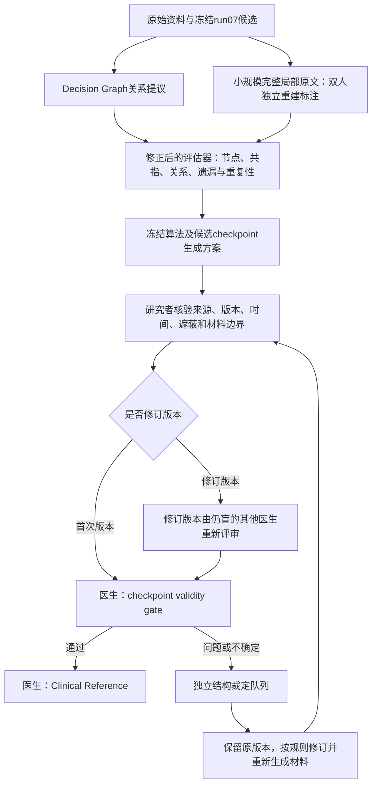

# P2 重建验证、checkpoint审计与医生盲评流程 v0.3

2026-10-23。当前执行流程，接续Decision Graph v0.2。旧P1结果、旧Episode/HEWV方案和旧研究者复核卡保留为历史材料；本流程不以P1 PASS、实际手术或模型标签作为患者门槛，不据既有就诊定义episode。

## 三道质量环节及两套独立标注依据

“小规模算法验证”是方法验证环节，不是要求每个患者都有人工gold才能进入候选检索的患者级门槛。具体是否达到扩大验证的条件，须按预先冻结的指标和误差容许范围决定；本轮未设自动接受阈值。

**重建标注依据A**：研究者/受训标注员直接阅读规定范围内完整原文，独立标注节点、事件和边；先独立、后比较分歧、再裁定。可以查看范围内后续文书来重建记载关系，但不能用结局改写早先事实或推定临床正确。双人角色尚待实际安排，程序不替代人类标注。

**临床Reference B**：医生只看该时点按方案可见、经核验的原始资料，先检查材料与决策问题是否可评价，再填写冻结表单中的Acceptable Mode Set、动作、Severity、Confidence等。历史医生选择、模型输出和后续结局均不充当答案。A与B分别存储、分别用人，不能从重建标注自动生成临床答案。

## checkpoint有效性门槛

“VALID”表示该版本的研究问题、时间边界及材料组织可以按方案评价，不要求资料足够推进手术、不要求只有一个可接受行动，也不自动证明它是首次真实决策或独立episode。

| 医生记录 | 含义与后续 |
|---|---|
| VALID | 可进入临床评价；关键未知可在PAUSE/补充取证、可接受动作和Confidence中表达 |
| REPAIR_REQUIRED | 提交一个或多个具体问题，停止该版本临床评分，进入结构裁定 |
| UNCERTAIN | 盲材料不足以判断有效性，保留原因并进入待核；不强迫判对错 |

问题代码为INVALID_DUPLICATE、INVALID_MIXED、INVALID_BOUNDARY、SUSPECTED_AVAILABLE_EVIDENCE_OMISSION、FUTURE_LEAKAGE、NOT_TARGET_DECISION、UNCERTAIN。它们首先是医生的**问题标记**，经结构核对后才成为已确认错误。

问题标记作用于具体packet版本或时点，NOT_TARGET_DECISION也不自动排除该患者的其他记录或候选episode。

- 复合计划不因动作多而自动INVALID_MIXED。只有包混合了需要分别评价的独立管理问题，才考虑拆分；同一次修订可含取消旧动作和选择新动作。
- 检查未做、已计划但未返回、原文明确无法判断，均不自动使checkpoint无效。引用原报告未在交付中找到时保留二手原文与来源等级，是否影响评价另判。
- “资料遗漏”仅指有理由认为当时已可见且本应纳入材料的来源被遗漏。医生先记疑似，结构人员核查。不得补入后来返回的结果来“修好”早期材料。
- 盲材料不足以区分duplicate与reaffirm时选择UNCERTAIN。不得为了判重给医生开放后续完整轨迹。

## 材料制作与盲法隔离

算法图、关系理由、模型分歧和置信度只在研究者目录。医生只接收中性研究问题、当前原文和按方案允许的历史资料；不显示“模型认为重复/应改ERCP”等提示。结构不确定性用于后台排队，不成为医生可见的预设答案。

进入医生环节前，研究者必须登记来源/版本/时间/遮蔽核验、包hash、截点、规则版本和审核者。排序代理不能充当历史可见性证明。研究者关系卡和本轮重建标注包包含当次选择及后续内容，**不能直接转成临床盲评包**。当前代码只登记已完成准备审核的包元数据，尚未自动制作正式临床包。

Clinical Reference表单必须在包注册前固定版本与schema hash；本模块不重新定义临床mode、Severity或Confidence等级。现有四问接口属于历史独立测试，其CONTINUE/PAUSE/EXIT等名称不能悄悄替换正式方案中的既定动作或Mode；正式使用哪版表单需在protocol字段明确。

## 结构裁定、修订和重盲评

结构人员可查看必要的完整轨迹，记录merge/split/move boundary/rebuild evidence/off-scope/no-change/unresolved、具体来源依据、规则版本、责任人和时间。操作不自动等于确认算法错误；保留confirmed_error字段。

原自动proposal和packet版本不得覆盖。新包保留所有父版本、原始proposal根、修订原因及hash；合并保留所有原根，拆分保留共同原根。UNRESOLVED和OFF_SCOPE不能直接进入临床评分。

修订后重新进行来源和边界准备审核，由其他仍盲的医生从validity gate重新开始。参与该患者结构裁定、看过模型/未来资料、或已看过更晚患者状态的评审者，被登记为不适合相应盲评。代码只约束已登记的接触史，不能替代人员权限与实际盲法组织。

若已有临床评分后另一位评审者标记结构问题，旧评分保留但隔离，不混入最终Reference。不得在同一医生现场合并/移动边界后继续给修订包评分。最终独立双评、分歧处理和表单人数按冻结方案；本地台账默认需要2份有效性通过，人数可在建账时预先指定，不能中途更改。

接触史按发生顺序登记。医生在已封存评分之后才接触后来资料，不反向改变当时已盲评的事实；该接触会阻止后续不适合的评分。若评分所绑定的包后来被判为结构有误或被修订，则该版本评分仍按结构规则隔离。系统不自动抹掉真实的先前独立评价。

## 指标与分母

1. 算法层：完整局部范围的节点检出/类型、共指pairwise和B³、事件对齐后的Decision–Decision关系与过程边分别计分、候选边召回及完整图。Oracle-node任务与端到端任务分别标记，不能混合汇总。当前自动评估主要实现严格原文跨度/类型对齐；自然语言signature语义正确性仍需人工对照，不能把字面一致率当准确率。
2. 数据集层：首次自动proposal版本的有效、问题、待评数量。分别报告VALID/全部proposal及VALID/已完成有效性评审proposal，公布待评数。不能只在最终修订成功的包上报告“自动可评价率”。
3. 修订负担：医生标记率与裁定确认错误率分开；以原proposal去重计数，另报修订动作/版本数，避免同一包反复修改重复进入原始错误率分母。
4. 人力：显式记录实际工作时长与缺测，不从程序运行时间估计医生时间。报告每包或裁定时长的中位数时同时报告有时长记录的比例。
5. 临床层：在最终冻结且通过门槛的包上形成Reference，后续Agent按相同可见证据评价。Validity不等于临床动作正确，Reference也不能反推所有图边正确。

模型之间一致、重复结果稳定或图约束通过均不构成已校准高置信度。此次仍使用博约kimi-k3；未增加第二模型、embedding、ProblemThread、episode算法或AUTO阈值。

## 本轮已推进

- 实际修复事件级评估与FP/曲线分母，新增分任务指标与显式scope。
- 增加read_write/read_only/refresh/bypass，独立调用不向prompt加nonce；每次响应另存，不覆盖历史实验。
- 准备6个开发局部范围、132份完整原文，A/B材料一致；随机来源、零命中、反馈及多动作挑战分层只在研究者清单中显示。这是开发试标材料，不代表P0分布或独立验证集。
- 完成一组固定规范化和固定关系任务各3次新API请求。仅合成文本；真实资料未远程发送。结果与失败原样保存，尚未形成任何真实人工gold、医生Reference或临床准确率。

执行代码与操作命令见 `scripts/cohort_construction/p2_relation_graph/VALIDATION.md`；标注手册见同日 `P2-重建标注手册-v0.1`。历史run与v0.2发布记录保留，新变更另记v0.3。
